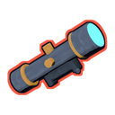
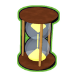

<p align="center"></p>

<h1 align="center">ror2-plus</h1>

<p align="center">A Risk of Rain 2 expansion mod: every Risk of Rain and Risk of Rain Returns item that RoR2 never got, plus a void version of every item that lacked one.<br>
<b><a href="https://asdfboy.github.io/ror2-plus/">Project page</a></b> · <a href="https://github.com/ASDFboy/ror2-plus/releases/latest">Download</a> · <a href="dist/CHANGELOG.md">Changelog</a></p>

<p align="center">      </p>

## What's in it
- **52 new items and equipment** from Risk of Rain (2013) and Risk of Rain Returns, rebuilt for RoR2's combat and balanced against vanilla items of the same rarity. Each has a painted icon in the game's style, a 3D pickup model, a spot on every survivor, logbook lore, and the game's own sounds and effects.
- **156 void items**: a void version of every white, green and red item that didn't have one, from the base game, all the DLCs and ror2-plus itself.
- **45 unlocks**, with challenges carried over from the older games (or swapped for something in the same spirit), each with its own challenge icon.
- **4 classic artifacts**: Distortion, Spirit, Origin and Tempus.
- **A lunar rework**: lunars are harder to get, but their downsides are gentler. Every change can be tuned or switched off.
- **A real expansion**: ror2-plus sits in the lobby's Expansions row next to the official DLCs, so you can switch it off for a run.

The full item list, unlocks and lunar table are on the [project page](https://asdfboy.github.io/ror2-plus/) and in [dist/README.md](dist/README.md), which is also the mod's Thunderstore readme.

## Install
1. Install [r2modman](https://thunderstore.io/c/riskofrain2/p/ebkr/r2modman/) and pick Risk of Rain 2.
2. Download `ror2-plus-<version>.zip` from the [latest release](https://github.com/ASDFboy/ror2-plus/releases/latest).
3. In r2modman, go to **Settings → Import local mod** and choose the zip.
4. Don't run ClassicItemsReturns at the same time; ror2-plus already includes everything it has.

## Building from source
You need the .NET SDK (8 or newer), and the game's DLLs in `libs/`. They aren't in this repo because they aren't ours to share.

1. From your Risk of Rain 2 install (`Risk of Rain 2_Data/Managed`), copy every DLL into `libs/`.
2. From an r2modman profile with the dependencies in `dist/manifest.json` installed, copy:
   - the BepInEx core, MonoMod, Mono.Cecil, Harmony and `MMHOOK_RoR2.dll` files into `libs/BepInEx/`;
   - the R2API DLLs into `libs/R2API/`;
   - `ShaderSwapper.dll` and `SneedHooks.dll` into `libs/HardDependencies/`;
   - `RiskOfOptions.dll`, `RiskyMod.dll` and `AssistManager.dll` into `libs/SoftDependencies/`.
3. Make RoR2's private members visible to the compiler. Run this from `tools/publicize`:

   ```
   dotnet run -- ../../libs/RoR2.dll ../../libs/RoR2.public.dll ../../libs ../../libs/BepInEx
   ```
   Then replace `libs/RoR2.dll` with `libs/RoR2.public.dll`.
4. Run `tools/package.sh`. It builds the DLL and writes the mod zip to `out/`.

`tools/check_lunar_patches` checks the lunar rework's code patches against your copy of the game without launching it. Run it after a game update with `dotnet run` from that folder.

## Repo layout
| Path | What's there |
|---|---|
| `src/` | The mod (C#). New ror2-plus content is in `src/Items/Complete`, `src/Lunar` and `src/Artifact/ClassicArtifacts.cs`. |
| `art/` | Item, void, artifact and achievement icons, the expansion emblem, and the 3D pickup models. |
| `tools/` | Python and Blender scripts that make the art, the tables and the project page, and the build helpers. |
| `dist/` | The mod package: manifest, readme, changelog, and the ClassicItemsReturns asset bundle, soundbank and translations. |
| `docs/` | The project page (GitHub Pages), built by `tools/make_site.py`. |

## Credits
- **ror2-plus:** ASDFboy and Claude.
- **ClassicItemsReturns**, the base this is built on, including its models, sounds and translations: DestroyedClone, Moffein and contributors. Used with their permission.
- Item concepts come from Risk of Rain and Risk of Rain Returns by Hopoo Games. This project isn't affiliated with Hopoo Games or Gearbox.

ClassicItemsReturns doesn't publish a license, so its code and assets in this repo stay theirs. ror2-plus is shared here for playing and learning; ask before reusing its art.
